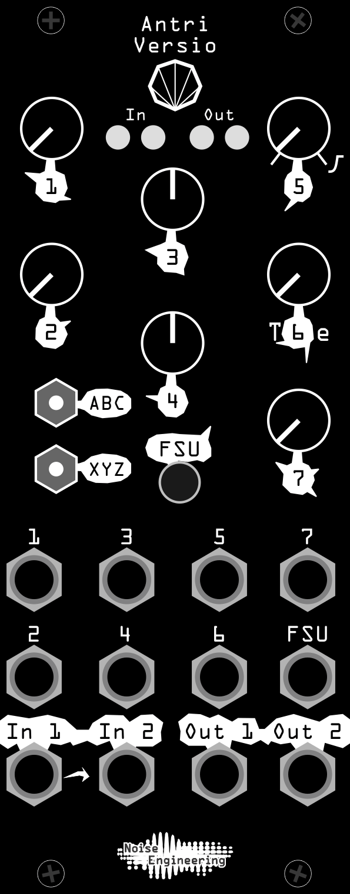
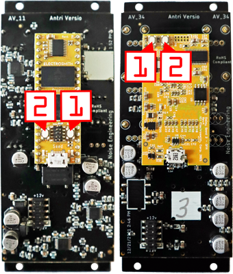

# open-versio

Open-source framework for making custom firmware for Noise Engineering's [Versio](https://noiseengineering.us/products/versio/) platform
module. Rules and skills for common agentic systems are provided.

# What is versio?

[Versio](https://noiseengineering.us/products/versio/) is a 10HP eurorack module built for stereo effects: seven knobs with CV inputs, two three-way switches, a button and gate jack, and four RGB LEDs. It builds on the [Electrosmith Daisy Seed](https://daisy.audio/) for its core computing.

# TL;DR

Prompt for agent: `I'd like to make a versio firmware using https://github.com/noiseeng/open-versio`

Detailed instructions in [HUMANS.md](HUMANS.md).

* Install Node 24 or newer [Download Node](https://nodejs.org/en/download)
* Fork this repository
* Clone your fork
* Run `npm i` to setup the Node environment
* Run `npm run setup` to download needed tools (like GCC)
* Run `npm run build` to compile
* Run `npm run flash` to connect to an attached (via USB) module and update the firmware
* Run `npm run debug` to flash a test build and see its log (via USB)
* Windows: If USB doesn't work you may need to install [Zadig](https://github.com/pbatard/libwdi/releases/download/v1.5.1/zadig-2.9.exe) to access STM's USB DFU.

Have fun creating!

# What is open-versio?

open-versio is a very narrow extract of Noise Engineering's internal embedded
development library *lacerti* that we started work on in 2019 when we moved to
using STM MCUs. It provides a minimal bare-metal hardware access layer and a
trivial example firmware. A minimal set of scripts for building,
running, and debugging is also provided. These work on all major OS without
the user needing to install system software other than [node](https://nodejs.org/en/download) and largely without the need for a jtag probe (logging and crash reporting are handled over USB).

The goal is to reduce the barrier to entry and complexity for user development of software for [Versio](https://noiseengineering.us/products/versio/).
A lot was simplified for this repository to make things easier for a single user making a single firmware. We have seen a massive increase in the use of LLMs to help write firmware for our platforms so we have also provided a set of instructions meant to be used by various agents.

# What isn't this?

This does not contain any of our DSP code.

This is not a fully featured library for ARM development.

This is not indicative of how Noise Engineering develops firmware internally apart from the hardware interface layer.

# Hardware requirements

* A computer running Windows, MacOS, or Linux
* A [Versio](https://noiseengineering.us/products/versio/) module, in a powered eurorack case
* A USB cable from the module to your computer, for `npm run flash` and `npm run debug`

If `npm run flash` can't find the module, put it in DFU mode: hold button 1, tap button 2, then release button 1.
The buttons are on the Daisy Seed on the back of the module; their position depends on the board revision.

No debug probe is needed. `npm run debug` flashes and prints the firmware's log
over USB, which allows basic debugging without a debug probe.

* Optional: a SEGGER J-Link (with software installed) or an ST-Link debug probe
* Warning: using JTAG will require soldering a header to the seed. This will violate the warranty on the product. If you are not comfortable with this don't use JTAG. You have been warned.

# Going back to official firmware

Official firmware is free and can be put back at any time from the [Noise Engineering firmware page](https://noiseengineering.us/portal/firmware/).

# Warnings

 * Physically modifying a Versio (or a seed) voids the warranty.
 * Modifying any option bytes in the H750 also voids the warranty as this can break firmware updates.
 * We love the hacker ethos but we are not responsible for your mistakes.
 * Replacement seeds are available through [Electrosmith](https://daisy.audio/)

# About Lacerti

Lacerti is a bare-metal, zero-dependency, header-only library for embedded
development targeting modern C++ and extensively using templates and other
modern C++ features to simplify development and improve performance. We do not
have plans to open source the entirety of this library at this time.

### Design Principles

* Single TU firmware compilation (LTO without LTO)
* Header only
* Maximize constexpr
* Typesafe arrays (like std::array)
* Hardware is configured at compile time so the compiler can detect common misconfigurations
  * for example `using usart3_rx_c11 = gpio_bit<adr_h750::GPIOC, 11, 7>;` defines a type to represent PC11 configured for usart3 rx usage. If misused it can generate a compile error.
* No external code: Lacerti does not use HAL, CMSIS, libc, libm, libdaisy
* Lacerti does use C++ headers that don't require external TUs eg algorithm
* internally we support stm32 f042,f072,h750,h747,mp1 and have some support for nordic nrf52.

open-versio violates a few of these goals in trivial ways because it
simplifies development for simple use cases. For example, Lacerti does not use
libm or libc, but it's easier most of the time to use them, so open-versio
does.

# Contributions and Community

* Contributions are accepted only as issues reported via github.
* At this point we do not accept third party code submissions.
* [Our Discord](https://discord.gg/hGNaCRZhn) has a channel #firmware-makers that is a good place for discussion.

# License (MIT) 

Copyright (c) 2019-2026 Noise Engineering

Permission is hereby granted, free of charge, to any person obtaining a copy
of this software and associated documentation files (the "Software"), to deal
in the Software without restriction, including without limitation the rights
to use, copy, modify, merge, publish, distribute, sublicense, and/or sell
copies of the Software, and to permit persons to whom the Software is
furnished to do so, subject to the following conditions:

The above copyright notice and this permission notice shall be included in all
copies or substantial portions of the Software.

THE SOFTWARE IS PROVIDED "AS IS", WITHOUT WARRANTY OF ANY KIND, EXPRESS OR
IMPLIED, INCLUDING BUT NOT LIMITED TO THE WARRANTIES OF MERCHANTABILITY,
FITNESS FOR A PARTICULAR PURPOSE AND NONINFRINGEMENT. IN NO EVENT SHALL THE
AUTHORS OR COPYRIGHT HOLDERS BE LIABLE FOR ANY CLAIM, DAMAGES OR OTHER
LIABILITY, WHETHER IN AN ACTION OF CONTRACT, TORT OR OTHERWISE, ARISING FROM,
OUT OF OR IN CONNECTION WITH THE SOFTWARE OR THE USE OR OTHER DEALINGS IN THE
SOFTWARE.
